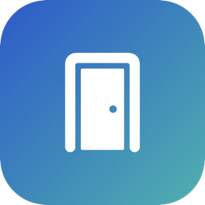
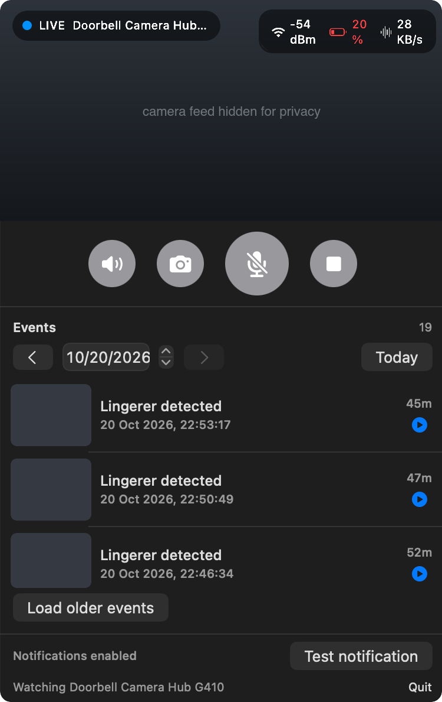
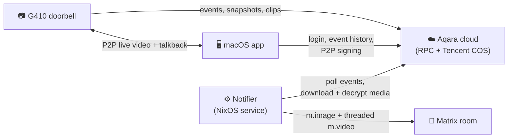

<div align="center">



# Aqara Doorbell

**An unofficial macOS client for the Aqara Doorbell Camera Hub G410.**
Live view and two-way talk from your menu bar, plus motion alerts with snapshot
and clip in Matrix. No Aqara Home app, no HomeKit hub.

[](https://github.com/nxm/aqara-doorbell/actions/workflows/ci.yml)
[](https://github.com/nxm/aqara-doorbell/releases/latest)
[](https://github.com/nxm/aqara-doorbell/releases)




</div>

---

## Install

### Homebrew (recommended)

```sh
brew install --cask nxm/tap/aqara-doorbell
```

### nix-darwin

```nix
homebrew = {
  enable = true;
  taps = [ "nxm/tap" ];
  casks = [ "nxm/tap/aqara-doorbell" ];
};
```

### Download

Get `AqaraDoorbell-<version>.dmg` from the
[latest release](https://github.com/nxm/aqara-doorbell/releases/latest) and drag
the app to Applications. It is a universal build for Apple silicon and Intel.

> **The app is not notarized.** Notarization needs a paid Apple Developer ID,
> which this project does not have, so macOS blocks the first launch of a
> downloaded copy. Open **System Settings → Privacy & Security** and click
> **Open Anyway**, or run
> `xattr -dr com.apple.quarantine /Applications/AqaraDoorbell.app`.
> Homebrew does this for you.

### From source

```sh
cd macos && ./make-app.sh      # needs Xcode or the Swift toolchain
cp -R AqaraDoorbell.app /Applications/
```

## Getting started

On first launch a **Sign in to Aqara** window asks for your region, email and
password. Use the account your doorbell is paired with in Aqara Home. The app
checks the login against Aqara's cloud before it saves anything. The password
goes to your login **Keychain**, and the region and email go to
`~/.config/aqara-doorbell/config.json`.

After that the app lives in the menu bar (look for the door icon) and has no
Dock icon. Click it to open live view. **Log out** in the popover forgets the
account.

> If the menu bar is full, macOS can hide new icons behind the notch. Hold `⌘`
> and drag other icons to make room.

## Features

**macOS menu-bar app** (`macos/`)
- 🔴 **Live view** over the camera's P2P link (H.264/HEVC, hardware decoded)
- 🎙️ **Two-way talk**: tap the mic button and speak through the doorbell
- 🗂️ **Event history** by day, with snapshots and in-app clip playback
- 🔔 **Native notifications** on motion, with the event snapshot attached
- 📶 Signal, battery and bitrate at a glance

**Matrix notifier** (`notifier/`)
- Polls the event history and posts each event's **snapshot** to a room
- The **clip** follows as a threaded reply under the snapshot
- Logs in on its own, finds your camera, caches tokens and backs off on rate limits
- Ships as a hardened **NixOS module** or a plain Python script

## How it works



Both parts use the same reverse-engineered cloud API, so there is no local hub
and no extra hardware. Signing, login, media decryption and the P2P handshake
are written up in [`docs/PROTOCOL.md`](docs/PROTOCOL.md).

## Matrix notifier

See [`notifier/README.md`](notifier/README.md) for every environment variable.

### NixOS (flake)

```nix
{
  inputs.aqara-doorbell.url = "github:nxm/aqara-doorbell";

  # in a host's configuration
  imports = [ inputs.aqara-doorbell.nixosModules.default ];

  services.aqara-doorbell = {
    enable = true;
    environmentFile = config.age.secrets."aqara-doorbell-env".path;
    homeserver = "http://127.0.0.1:8008";
  };
}
```

### Standalone

```sh
nix run github:nxm/aqara-doorbell#notifier
# with AQARA_EMAIL, AQARA_PASSWORD, MATRIX_USER, MATRIX_PASSWORD, MATRIX_ROOM
# and MATRIX_HOMESERVER set
```

> **Tip:** point the notifier at Synapse directly (localhost or a tailnet
> address). Edge proxies such as Cloudflare often return 403 for
> `POST /_matrix/client/v3/login`.

## Configuration

`~/.config/aqara-doorbell/config.json` is written by the sign-in window. You
can add these keys by hand:

| Key | Default | Meaning |
|---|---|---|
| `pollSeconds` | `15` | How often to check for new events |
| `qualityChannel` | `0` | Stream quality to ask for after the first keyframe (`-1` keeps the camera's choice) |
| `useNativeP2P` | `true` | Use the built-in P2P stack (the only one in this repo) |

## Security notes

- The macOS app keeps your Aqara password in the login Keychain (service
  `aqara-doorbell`), never in a file.
- The notifier reads every credential from an `EnvironmentFile`. Keep that file
  in a secret manager such as agenix or sops, never in the Nix store or in git.
- Nothing here phones home. The only traffic goes to Aqara's cloud, the camera
  and your own Matrix server.

## Disclaimer

This is an independent, unofficial project. It is not affiliated with, endorsed
by, or supported by Aqara or Lumi United, and "Aqara" and related marks belong to
their owners. The protocol was reverse-engineered for interoperability with a
device the author owns, and the tools only talk to your own account. Aqara can
change its cloud at any time and break this. It comes with no warranty, so use
it at your own risk. No Aqara firmware or third-party code is included.

## License

[MIT](LICENSE)
